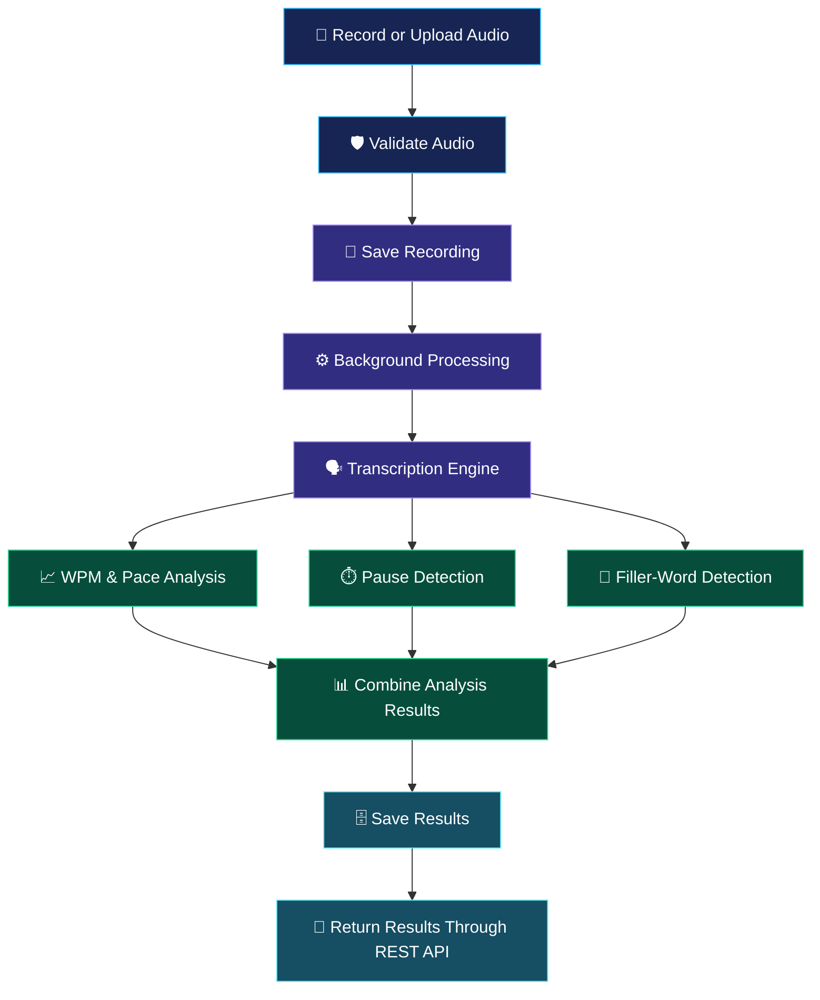

<!-- =========================================================
     BACKSTAGE BACKEND | GitHub README
     Theme: Midnight Navy • Electric Purple • Cyan • Mint
     ========================================================= -->

<div align="center">

<a href="https://github.com">
  
</a>

<br/>


<br/>

<p>
  
  
  
  
</p>

<p>
  
  
  
</p>

**A backend for practicing public speaking, analyzing delivery, and tracking improvement.**

[Features](#-features) · [Architecture](#-how-it-works) · [Quick Start](#-quick-start) · [API Reference](#-api-reference) · [Contributors](#-team--contributions)

</div>

---

## ✨ What is Backstage?

**Backstage** is a public-speaking rehearsal coach. Users record a speech or upload an audio file, and the backend processes the recording to provide useful feedback on speaking pace, pauses, filler words, and transcription.

The goal is simple: help speakers understand their delivery, identify areas for improvement, and build confidence through repeated practice.

This repository contains the **backend application**, built with Django REST Framework, SQLite, and a speech-processing pipeline powered by `faster-whisper` when available.

> 🎙️ **Record → Transcribe → Analyze → Improve**

---

## 🎨 Features

<table>
<tr>
<td width="50%" valign="top">

### 🎙️ Speech Recording

- Accept audio uploads.
- Validate recording duration and supported formats.
- Associate recordings with practice prompts.
- Track processing status.
- Delete recordings and their associated results.

</td>
<td width="50%" valign="top">

### 🧠 Speech-to-Text

- Integrate `faster-whisper` for transcription.
- Generate a mock response when the mock engine is enabled.
- Support language and model configuration.
- Return transcript text with word-level timestamps when provided by the transcription engine.

</td>
</tr>
<tr>
<td width="50%" valign="top">

### 📊 Speaking Analysis

- Calculate words per minute (WPM).
- Evaluate speaking pace against configurable targets.
- Detect pauses and classify longer gaps.
- Identify configured filler words.
- Return a structured performance breakdown.

</td>
<td width="50%" valign="top">

### 🔐 Authentication & Access

- User registration and login.
- JWT access and refresh tokens.
- User-specific recording access.
- Owner/admin permission checks.
- Django admin for authorized administration.

</td>
</tr>
<tr>
<td width="50%" valign="top">

### 📚 Practice & Progress

- Browse prompt categories and topics.
- Search and filter prompts.
- View recording history.
- Track attempts over time.
- Manage personal and global filler-word lists.

</td>
<td width="50%" valign="top">

### ⚙️ Developer-Friendly Setup

- One-command development startup.
- Automatic virtual environment and dependency setup.
- Database migration support.
- Test and API-check commands.
- Optional Whisper installation and mock mode.

</td>
</tr>
</table>

---

## 🏗️ Technology Stack

| Technology | Purpose |
|---|---|
| Python | Backend programming language |
| Django | Web framework and application foundation |
| Django REST Framework | REST API endpoints and serializers |
| Simple JWT | Token-based authentication |
| SQLite | Development database |
| faster-whisper | Speech transcription |
| Mock transcription engine | Development and fallback testing |
| Django Admin | Administrative interface |
| Python unittest / Django tests | Automated testing |

---

## 🔄 How It Works

<div align="center">



</div>

### Processing lifecycle

1. The API validates the uploaded audio and applicable recording limits.
2. The recording is saved and its status becomes `processing`.
3. The processing pipeline transcribes the audio using the configured engine.
4. The analysis services calculate pace, pauses, and filler words.
5. The backend stores the results and marks the recording `completed`, or records an error if processing fails.
6. The authenticated user retrieves the transcript and analysis through the API.

**Privacy note:** The documented processing flow deletes the uploaded audio after processing. Review the implementation and deployment configuration before using sensitive or personal recordings.

---

## 📁 Project Structure

```text
backend/
├── run.py                   # Development setup and startup helper
├── manage.py                # Django management commands
├── try_api.py               # API smoke-check script
├── requirements.txt         # Core Python dependencies
├── requirements-whisper.txt # Optional transcription dependencies
├── .env.example             # Environment variable template
│
├── config/                  # Django settings, URLs and API utilities
├── accounts/                # Registration, login and user identity
├── prompts/                 # Prompt categories and prompt endpoints
├── recordings/               # Audio upload and recording endpoints
├── analysis/                 # Analysis results and progress endpoints
├── appconfig/                # Filler words, settings and seed command
├── console/                  # Lightweight backend test console
│
└── services/
    ├── types.py              # Shared data structures
    ├── transcription.py      # Whisper and mock transcription
    ├── wpm.py                # Pace and WPM calculations
    ├── pauses.py             # Pause detection
    ├── fillers.py            # Filler-word detection
    ├── breakdown.py          # Analysis response construction
    ├── pipeline.py           # Recording processing workflow
    └── jobs.py               # Background processing orchestration
```

*The exact files may vary slightly depending on the submitted repository version.*

---

## 🚀 Quick Start

### Requirements

- Python 3.9 or newer; Python 3.10–3.13 is recommended.
- Internet access for first-time dependency installation and Whisper model download.
- A microphone or an audio file for testing.

### Option 1 — Recommended: one command

Open the complete project in VS Code, then open a terminal in the `backend/` directory.

**Windows**

```powershell
python run.py
```

If `python` is not recognized:

```powershell
py run.py
```

**macOS / Linux**

```bash
python3 run.py
```

The startup helper is designed to prepare the virtual environment, install dependencies, apply migrations, prepare the configured transcription engine, start the server, and open the browser. First-time setup may take several minutes.

Open:

- Backend console: `http://127.0.0.1:8000/`
- Django admin: `http://127.0.0.1:8000/admin/`

Stop the server with `Ctrl+C`.

### Option 2 — Manual setup

Run these commands from the `backend/` directory.

**Windows**

```powershell
python -m venv venv
venv\Scripts\activate
python -m pip install -r requirements.txt
python -m pip install -r requirements-whisper.txt
python manage.py migrate
python manage.py runserver
```

**macOS / Linux**

```bash
python3 -m venv venv
source venv/bin/activate
python -m pip install -r requirements.txt
python -m pip install -r requirements-whisper.txt
python manage.py migrate
python manage.py runserver
```

If you use the manual setup, create an administrator separately when needed:

```bash
python manage.py createsuperuser
```

---

## 🎧 Whisper vs. Mock Mode

Backstage supports two transcription modes.

| Mode | Behavior |
|---|---|
| `faster-whisper` | Processes the actual audio using the configured Whisper model |
| `mock` | Returns predefined demonstration content; it does not transcribe the uploaded audio |

When mock mode is active, the application is expected to display a `MOCK` warning. Mock output is useful for testing application flow, but **it is not valid evidence of real speech-recognition accuracy**.

### Prepare the Whisper model

```bash
python manage.py prepare_whisper
```

### Analyze a local audio file

```bash
python run.py analyze speech.wav
```

Optional examples:

```bash
python run.py analyze speech.wav --language bn
python run.py analyze speech.wav --model small
```

Check `python run.py --help` if the available arguments differ in your version.

To disable Whisper installation and use the mock engine:

```bash
python run.py --no-whisper
```

For strict transcription behavior, configure the environment as documented by the application:

```dotenv
TRANSCRIBER=faster-whisper
```

If the real engine is required but unavailable, the intended behavior is to fail rather than silently present mock output as real transcription.

---

## 🔑 Demo Accounts

Demo accounts can be created locally using the project's seed command.

```bash
python manage.py seed_demo --users
```

This command is intended to create:

- `admin` — administrative testing account.
- `demo` — regular user account.

**Important:** Demo passwords are maintained separately by the team. Obtain them through the authorized credentials handoff; do not put passwords, API keys, or production secrets in this README or in Git.

To create an administrator manually:

```bash
python manage.py createsuperuser
```

---

## 🔌 API Reference

All API endpoints use the `/api/v1/` prefix.

Except for registration and login, requests require a valid access token:

```http
Authorization: Bearer <access_token>
```

### Authentication

| Method | Endpoint | Purpose | Access |
|---|---|---|---|
| `POST` | `/api/v1/auth/register/` | Create an account | Public |
| `POST` | `/api/v1/auth/login/` | Obtain access and refresh tokens | Public |
| `POST` | `/api/v1/auth/refresh/` | Refresh an access token | Public |
| `GET` | `/api/v1/auth/me/` | Get the current user's identity and admin status | Authenticated |

### Prompts

| Method | Endpoint | Purpose |
|---|---|---|
| `GET` | `/api/v1/categories/` | List prompt categories |
| `GET` | `/api/v1/prompts/` | List, search and filter prompts |
| `GET` | `/api/v1/prompts/{id}/` | Retrieve one prompt |

Available filters include `category`, `search`, and `language`, where supported.

### Recordings & Analysis

| Method | Endpoint | Purpose |
|---|---|---|
| `POST` | `/api/v1/recordings/` | Upload an audio recording |
| `GET` | `/api/v1/recordings/` | List the authenticated user's recordings |
| `GET` | `/api/v1/recordings/{id}/` | Check status and recording summary |
| `DELETE` | `/api/v1/recordings/{id}/` | Delete a recording and its results |
| `GET` | `/api/v1/recordings/{id}/transcript/` | Retrieve transcript and word timings |
| `GET` | `/api/v1/recordings/{id}/analysis/` | Retrieve the full analysis |
| `GET` | `/api/v1/progress/` | Retrieve progress across attempts |

Recording upload uses `multipart/form-data` with a file field named `audio`. Optional fields include `prompt_id` and `language`, as supported by the API.

The documented recording duration limits are **10 seconds minimum and 300 seconds maximum** by default.

### Filler Words & Settings

| Method | Endpoint | Purpose |
|---|---|---|
| `GET` | `/api/v1/filler-words/` | List available and personal filler words |
| `POST` | `/api/v1/filler-words/` | Add a filler word |
| `PATCH` | `/api/v1/filler-words/{id}/` | Edit or disable a word |
| `DELETE` | `/api/v1/filler-words/{id}/` | Delete a word |
| `GET` | `/api/v1/settings/` | Read analysis settings |
| `PATCH` | `/api/v1/settings/{key}/` | Update a setting; admin access required |

Lists may support pagination with `page` and `page_size`.

---

## 🧪 Testing & Validation

Run the automated test suite:

```bash
python run.py test
```

Run Django's system checks:

```bash
python manage.py check
```

Run the API smoke checks while the development server is running, in a separate terminal:

```bash
python try_api.py
```

To test with a particular recording:

```bash
python try_api.py my_speech.wav
```

The smoke-check script is intended to exercise the running API, including user registration, upload, and related requests.

**Testing note:** The team submission reports 136 backend tests and Django system checks. Run the commands above on the final commit to independently verify the current repository state before a release or handoff.

---

## ⚙️ Environment Configuration

Create a local `.env` file from the supplied template:

```bash
# Copy .env.example to .env, then edit if necessary.
```

For example, on Windows:

```powershell
Copy-Item .env.example .env
```

Environment variables can configure the transcription engine, language, and other application settings. Check `.env.example` and the Django settings module for the exact supported names and defaults.

**Security checklist**

- Never commit `.env` files containing real secrets.
- Keep demo credentials outside the public repository.
- Use a strong secret key for deployed environments.
- Set production `DEBUG` to `False`.
- Configure allowed hosts and CORS origins for the actual deployment.
- Do not expose sensitive recording data or authentication tokens in logs.

---

## 🛠️ Configurable Analysis Settings

The backend provides application settings that can be read through the API and, for authorized administrators, updated through the settings endpoint or Django admin.

| Setting | Default | Description |
|---|---:|---|
| `max_recording_seconds` | `300` | Maximum recording duration |
| `min_recording_seconds` | `10` | Minimum recording duration |
| `wpm_target_min` | `120` | Lower target pace in words per minute |
| `wpm_target_max` | `160` | Upper target pace in words per minute |
| `pacing_window_seconds` | `30` | Window used for pace analysis |
| `pause_min_seconds` | `0.5` | Minimum gap considered a pause |
| `pause_dramatic_min_seconds` | `1.0` | Threshold for a dramatic pause |
| `pause_long_min_seconds` | `3.0` | Threshold for a long pause |
| `whisper_model` | `base` | Configured Whisper model size |
| `default_language` | `en` | Default transcription language |

These values are starting points and may require adjustment for different speakers, languages, or evaluation goals.

---

## 📦 Recording Status & Error Handling

A recording normally follows this lifecycle:

```text
processing → completed
           ↘ failed
```

After uploading, poll the recording endpoint every two to three seconds until the status changes.

The API uses structured error responses. For example:

```json
{
  "error": {
    "code": "audio_too_short",
    "message": "The recording is too short. Minimum is 10 seconds."
  }
}
```

Common error codes include:

| Code | Meaning |
|---|---|
| `validation_error` | Invalid request or field |
| `audio_too_short` | Recording is below the minimum duration |
| `audio_too_long` | Recording exceeds the duration limit |
| `unauthorized` | Missing or invalid authentication |
| `forbidden` | Insufficient permission |
| `not_found` | Resource does not exist or is not accessible |
| `not_ready` | Processing is not complete |
| `recording_failed` | Recording processing failed |
| `file_too_large` | Uploaded file exceeds the limit |
| `unsupported_format` | Unsupported audio format |
| `too_many_requests` | Request rate limit exceeded |

Exact status codes and error details are determined by the endpoint implementation.

---

## 👥 Team & Contributions

Backstage was developed collaboratively by **Group 8**, with responsibilities distributed across backend configuration, APIs, audio processing, analysis services, and testing.

| Team Member | Role | Main Contributions |
|---|---|---|
| **Nayeem** | Team Leader · Backend Integration | Django configuration, authentication, API integration, processing pipeline coordination, backend console core, and development setup/runtime workflow. |
| **Tandra** | Audio & Recording Services | Audio upload workflow, recording APIs, audio handling, Whisper/transcription integration, and recorder-related functionality. |
| **Nujhat** | Prompts & Analysis Services | Prompt management, application settings, progress endpoints, WPM and pause analysis, recording API contracts, and analysis breakdown orchestration. |
| **Sadia** | Filler Detection & Testing | Filler-word functionality, filler/pause-related tests, seed data, and Whisper setup commands. |

*Contributions describe the team's assigned areas of work and collaboration. Individual implementation and testing details should be verified against the final repository and project journal.*

---

## 📚 Documentation

The wider project documentation includes:

- **Project Requirements Document (PRD):** objectives, users, and functional requirements.
- **System Design:** architecture, application components, and processing flow.
- **Project Report:** implementation decisions, challenges, tools, and outcomes.
- **Deployment Guide:** instructions for preparing a deployment.

If these documents are stored in the parent project repository rather than this backend repository, link to their actual GitHub locations here after pushing. Avoid adding relative links that point to files absent from this repository.

---

## 🧭 Current Scope & Limitations

- Real transcription depends on the Whisper engine, compatible dependencies, and a downloaded model.
- Mock mode demonstrates the application flow but does not analyze the user's actual spoken words.
- Transcription accuracy and filler detection should be evaluated using real recordings, including different accents and supported languages.
- The included development setup is not a substitute for production deployment hardening.
- SQLite is convenient for local development; production database and media-storage choices should be reviewed for the intended hosting environment.

---

## 🌱 Future Improvements

- Expand speech-analysis metrics and personalized feedback.
- Improve multilingual transcription and filler-word detection.
- Add stronger integration and end-to-end tests.
- Improve processing reliability for long recordings.
- Add production-oriented storage, monitoring, and deployment configuration.
- Improve API documentation and automated API schema generation.

---

<div align="center">


### 🎤 Practice with purpose. Speak with confidence.

**Backstage Backend · Group 8**

<sub>Built to make every rehearsal count.</sub>

<br/>


</div>
